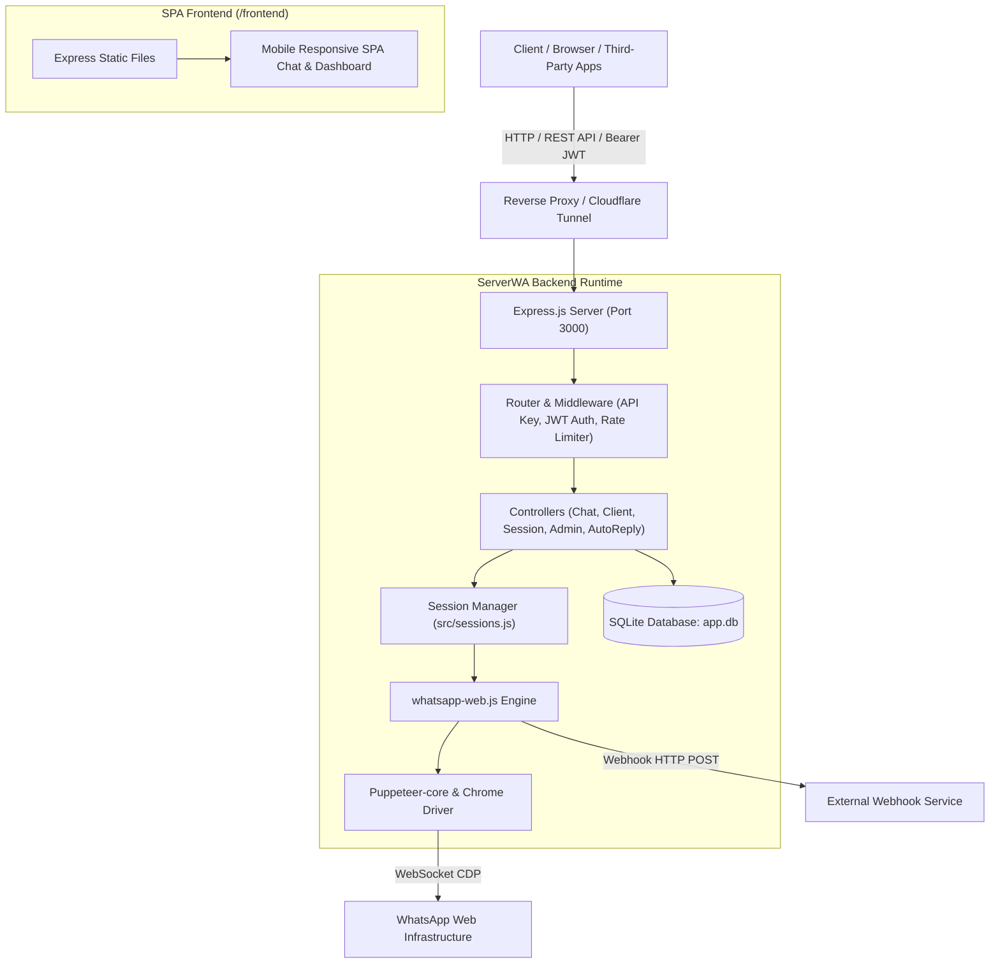
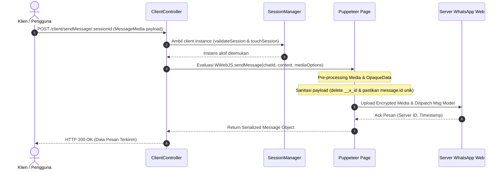

# Arsitektur Sistem ServerWA

Dokumen ini menjelaskan rancangan arsitektur, aliran data, dan modul internal dari aplikasi gateway WhatsApp REST API ServerWA (`oriwa3`).

---

## 1. High-Level Architecture

ServerWA bertindak sebagai jembatan *headless* antara klien HTTP (frontend web, webhook eksternal, atau integrasi aplikasi pihak ketiga) dengan layanan WhatsApp Web resmi melalui otomatisasi browser Chromium.

---

## 2. Komponen Inti & Tanggung Jawab

### A. HTTP Server & Routing (`src/app.js`, `src/routes.js`)
* **Express.js Engine**: Mengatur routing REST API untuk operasi session, interaksi chat, pengiriman media, katalog, auto-reply, dan autentikasi.
* **Middleware Pipeline** (`src/middleware.js`):
  * `apikey`: Validasi Global API Key atau autentikasi berbasis Bearer JWT.
  * `sessionOwnership`: Memastikan pengguna hanya dapat mengakses sesi miliknya sendiri (kecuali role `admin`).
  * `sessionValidation`: Memvalidasi status browser sesi WhatsApp masih aktif dan otomatis memperbarui timestamp aktivitas (`touchSession`).
  * `rateLimiter`: Proteksi anti-flood / DoS.

### B. Session Management Engine (`src/sessions.js`)
* **Multi-Session Registry**: Menggunakan `Map()` di memori Node.js untuk menampung instans client WhatsApp yang aktif.
* **Persistent Authentication**: Menggunakan `LocalAuth` (disimpan pada folder `./sessions/session-<id>`) agar session login tetap tersimpan tanpa scan ulang QR code.
* **Auto Recovery & Reconnection**: Memulihkan sesi saat terjadi kegagalan jaringan atau browser page restart.
* **Periodic Cleaner**: Pembersih sesi *dead/zombie* yang berjalan berkala. Sesi berstatus `CONNECTED` diproteksi agar tidak dimatikan paksa meskipun idle.

### C. WhatsApp Web Injected Script (`node_modules/whatsapp-web.js/src/util/Injected/Utils.js`)
* Melakukan injeksi JavaScript ke dalam konteks browser WhatsApp Web resmi untuk:
  * Mengirim pesan teks, tombol, polling, vCard, dan media (gambar, video, audio, dokumen).
  * Menangani sinkronisasi obrolan, kontak, label, dan unduhan file media.
  * *Hot-patched*: Menghilangkan properti internal `__x_id` untuk mencegah tabrakan memoize getter WhatsApp.

### D. Database Layer (`src/database.js`)
* Menggunakan **SQLite 3** (`better-sqlite3`) yang ringan dan berkinerja tinggi:
  * `users`: Data login akun pengguna dan peran (`admin` / `user`).
  * `user_sessions`: Kepemilikan sesi per pengguna.
  * `messages`: Penyimpanan riwayat pesan masuk dan keluar beserta referensi media lokal.
  * `auto_replies`: Aturan auto-reply teks otomatis berbasis kata kunci / regex.
  * `catalogs`: Manajemen katalog bisnis produk.

### E. Frontend Single Page Application (`frontend/`)
* Antarmuka web responsif (desktop & mobile) yang terintegrasi langsung dengan endpoint ServerWA:
  * Manajemen sesi (Start, Stop, QR Code, Status Live).
  * WhatsApp Web Chat UI lengkap dengan bubble pesan, tanda centang (read receipts), dan kirim/terima media.

---

## 3. Sequence Diagram Alur Pengiriman Pesan Media

---

## 4. Keamanan & Akses Kontrol

1. **Dual Authentication**:
   - **Global API Key**: Header `x-api-key` digunakan untuk integrasi backend-to-backend atau bot webhook.
   - **Bearer JWT**: Digunakan oleh user antarmuka web, memuat klaim user ID dan role (`admin` / `user`).
2. **Isolasi Kepemilikan Sesi**:
   - Setiap sesi terikat pada `user_id` di database `user_sessions`.
   - Regular user tidak dapat membaca, mengirim, atau menghapus sesi milik user lain.
   - Admin memiliki wewenang mengelola seluruh sesi yang terdaftar.
3. **Penyimpanan Kredensial & Sandi**:
   - Sandi di-hash menggunakan `bcryptjs`.
   - Token ditandatangani menggunakan `jsonwebtoken` dengan secret yang dapat dikonfigurasi melalui `.env`.
